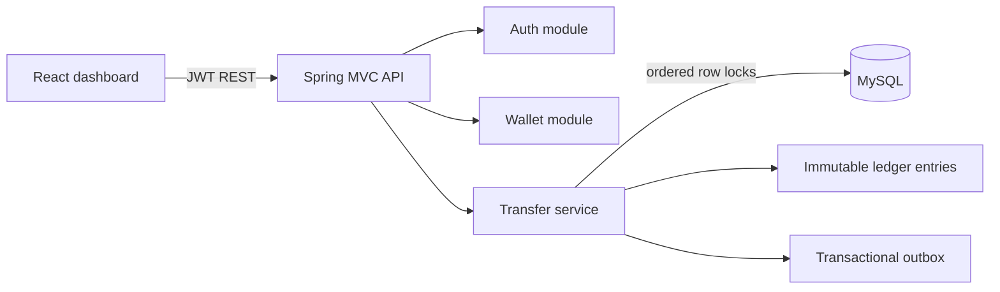
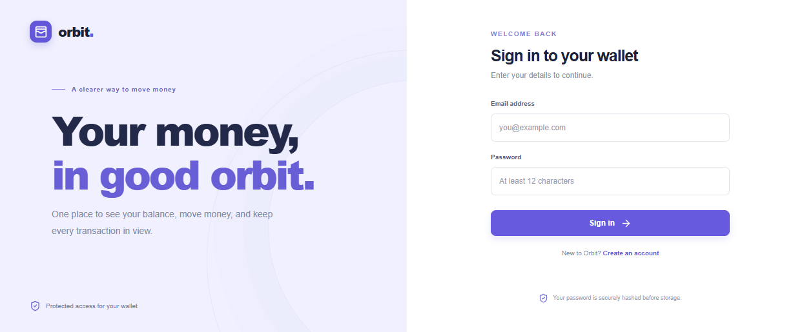

# Distributed Payment Wallet & Ledger

A portfolio project for a wallet and transfer service, built as a modular Spring Boot application with a React client. The design prioritizes atomic transfers, deterministic wallet locking, append-only ledger entries, and idempotent retries.

> This is a learning project, not a payment processor. Do not use it to hold or transfer real funds.

## Status

The initial implementation provides registration/login, wallet creation and balance lookup, wallet-to-wallet transfers, transfer history, a double-entry ledger, JWT-protected APIs, database migrations, and a responsive React client. MySQL is the source of truth; every transfer and its ledger/outbox records are written in one database transaction. Wallets start at zero; an external deposit/top-up flow is not implemented.

Redis caching, Kafka relay/consumers, administrative workflows, and full reconciliation reporting are infrastructure/design extension points, not claimed as implemented runtime features yet.

## Stack

- Java 21, Spring Boot, Spring MVC, Spring Data JPA, Spring Security, Bean Validation
- MySQL 8, Flyway; Docker Compose
- React, JavaScript, Vite, Axios, Tailwind CSS
- JUnit 5, Mockito, Spring Boot Test

## Architecture

The backend is a modular monolith, organized around auth, wallet, transfer, ledger, and shared API concerns. The transfer service is the transaction boundary. It locks both wallets in ascending UUID order, checks wallet status and available funds, updates balances, writes exactly one debit and one credit entry, and records the transfer and outbox event atomically.



See [docs/architecture.md](docs/architecture.md) for transaction behavior, data model, API details, failure handling, and trade-offs.

## Screenshots



## Run locally

Requirements: Docker Desktop and Node.js 20+. Start the database and application:

```powershell
docker compose up --build
```

The API is available at `http://localhost:8080`; the Vite dashboard is at `http://localhost:5173`.

For local development without Docker:

1. Start MySQL 8 and create a database/user matching `backend/src/main/resources/application.yml`.
2. Run the backend with `cd backend; .\mvnw.cmd spring-boot:run`.
3. Run the frontend with `cd frontend; npm install; npm run dev`.

Set `JWT_SECRET` to a base64-encoded random secret of at least 32 bytes before exposing the API beyond a local development environment.

## API

All routes are under `/api/v1`. Register and login are public; wallet and transfer routes require `Authorization: Bearer <token>`.

| Method | Path | Purpose |
|---|---|---|
| POST | `/auth/register` | Register a user and create their first wallet |
| POST | `/auth/login` | Authenticate and return a JWT |
| POST | `/wallets` | Create another wallet for the signed-in user |
| GET | `/wallets/{walletId}` | Read an owned wallet |
| GET | `/wallets/{walletId}/balance` | Read its available balance |
| GET | `/wallets/{walletId}/ledger` | Read its paginated ledger |
| POST | `/transfers` | Transfer funds; requires `Idempotency-Key` |
| GET | `/transfers/{transferId}` | Read a transfer involving the caller |
| GET | `/transfers` | Read the caller's paginated transfer history |

Amounts are positive decimal values with at most two fractional digits. Transfer requests use `{"sourceWalletId":"...","destinationWalletId":"...","amount":12.34,"currency":"USD"}`. Reusing an idempotency key with the same request returns the original transfer; reusing it for different input returns `409 Conflict`.

## Database scripts

The application applies database changes automatically with Flyway. To create a fresh MySQL database manually, run [database/schema.sql](database/schema.sql). Example wallet, transfer-history, ledger, outbox, and reconciliation queries are in [database/queries.sql](database/queries.sql); see [database/README.md](database/README.md) for commands and UUID notes.

## Tests

```powershell
cd backend
.\mvnw.cmd test
```

The suite includes service unit tests and H2 API integration tests for registration, successful transfer, idempotent retry, insufficient balance, concurrent overspend prevention, and transaction rollback. H2 tests do not replace MySQL/Testcontainers validation or production load testing.

## Engineering decisions

- One Spring Boot deployment keeps the consistency boundary explicit; do not split the transfer path into distributed services without a ledger-first migration plan.
- Row-level locks and canonical lock ordering serialize conflicting transfers and prevent the common opposite-direction deadlock. A requesting-user lock also serializes that user's transfer submissions to make idempotency races safe; this is a throughput trade-off.
- MySQL transaction rollback protects debit, credit, ledger, transfer, idempotency, and outbox writes as one unit.
- The outbox is persisted with the transfer to avoid losing the event intent. Kafka publishing, retries, monitoring, and consumer deduplication are not implemented yet.
- JWTs are stateless for this baseline. Add refresh-token rotation, key rotation, rate limiting, and operational secret management before production use.
