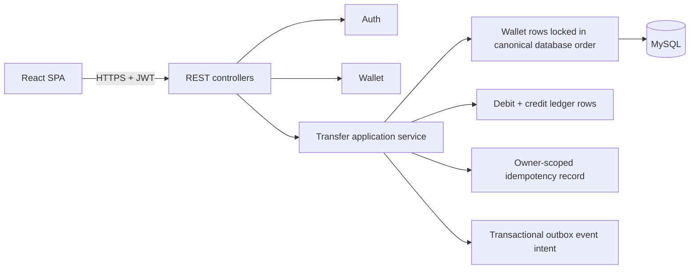
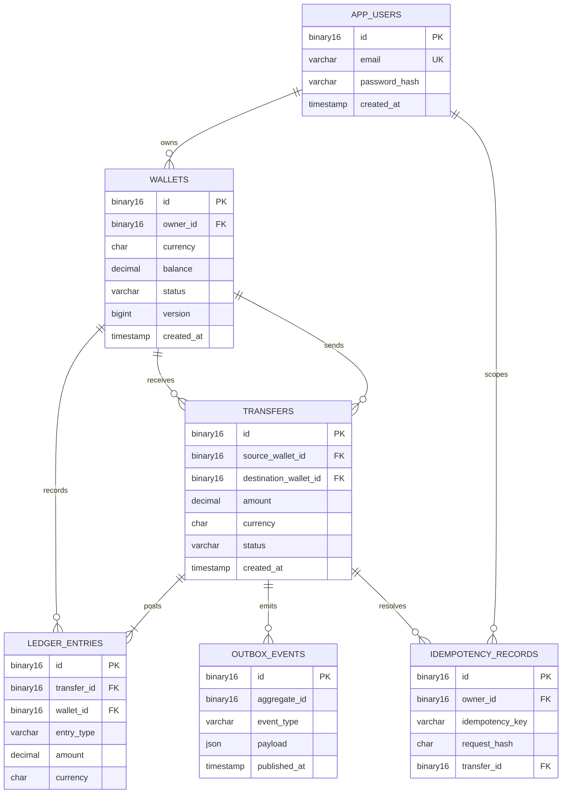
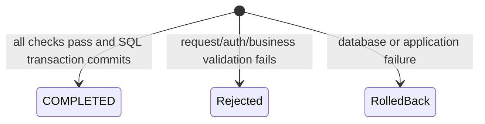

# Architecture and engineering notes

## Scope and trust boundary

This repository is a local portfolio implementation, not a production payment processor. The current runnable slice includes JWT registration/login, owned-wallet reads/creation, wallet-to-wallet transfers, paginated history/ledger reads, MySQL migrations, and a React client that calls those APIs. This release does not implement admin roles, wallet freeze controls, reconciliation jobs/reports, a Kafka publisher/consumer, event retry/DLQ, Redis caching, refresh tokens, or real payment rails.

The backend is a modular monolith. This keeps the debit, credit, ledger pair, idempotency result, and event intent inside one ACID transaction. Splitting the transfer path into separately committed services would require a substantially different saga and compensation design.

## HLD / modules



Controller DTO validation is the API boundary. Services enforce ownership and business invariants. Spring Data repositories own persistence and locking queries. Flyway owns schema evolution; Hibernate runs in `validate` mode and does not create or mutate the schema.

## LLD / transfer operation

`TransferService.create` runs in a Spring transaction:

1. Validate the idempotency key and lock the requesting account row. The account lock serializes writes per sender, ensuring concurrent same-owner requests re-check the committed idempotency record before processing.
2. Hash a canonical representation of source wallet, destination wallet, normalized amount, and currency. Same key/same hash returns the original transfer; same key/different hash returns HTTP 409.
3. Reject same-wallet transfers. Lock both wallet rows with a single ordered `SELECT ... FOR UPDATE` query.
4. Verify source ownership, active status, currency match, and sufficient available balance.
5. Apply the debit and credit in memory, then persist one `COMPLETED` transfer, one `DEBIT`, one `CREDIT`, one idempotency record, and one outbox event intent.
6. Commit once. Any runtime exception rolls back every write, including the wallet balance updates.

The `ledger_entries` unique constraint `(transfer_id, entry_type)` allows at most one debit and one credit per transfer. The service creates both rows in the same transaction. The database schema does not independently enforce that both rows exist; a reconciliation check is still needed before treating this as a production ledger.

## Database ER diagram



The `audit_logs` and `reconciliation_records` tables are present in schema migrations, but the application does not yet write audit records or generate reconciliation results.

## Transfer sequence

```mermaid
sequenceDiagram
  actor Client
  participant API as Spring API
  participant S as Transfer service
  participant DB as MySQL
  Client->>API: POST /transfers + JWT + Idempotency-Key
  API->>S: validated principal and request
  S->>DB: lock owner row; check key and request hash
  S->>DB: lock source/destination wallets ordered by ID
  S->>S: verify ownership, status, currency, balance
  S->>DB: update balances; insert transfer, 2 ledger rows, idempotency, outbox
  DB-->>S: commit atomically
  S-->>Client: transfer result
```

## Transfer state and errors

The implementation currently persists successful transfers only. Validation or persistence errors roll back the request and do not create a durable `FAILED` transfer record.



`Rejected` and `RolledBack` above describe request outcomes, not persisted transfer statuses. Adding durable pending/failed states requires an explicit state transition model and reconciliation policy.

## Concurrency and isolation

- MySQL/InnoDB transactions use the configured database isolation (normally `REPEATABLE READ`).
- A pessimistic account-row lock serializes transfers per requesting user to make same-key retries safe without relying on exception-based recovery from unique-key races. This is intentionally conservative and can limit throughput for high-volume senders.
- The wallet query locks both involved rows with an `ORDER BY id`, giving opposite-direction transfers a deterministic order and avoiding the common deadlock pattern.
- Wallets also carry a JPA `@Version` column as a second line of defense for future code paths that update without a pessimistic lock. The current transfer path uses pessimistic locking.
- The database balance `CHECK` disallows negative balances; the service checks funds before writing.

## Failure and retry behavior

| Scenario | Current behavior |
|---|---|
| Two transfers touch the same wallet | Row locks serialize the wallet changes; the later transaction re-reads the available balance after obtaining its locks. |
| Client retries with the same key and payload | Returns the original completed transfer without applying the debit or credit again. |
| Same key, changed payload | Returns `409 Conflict`. |
| Process fails before commit | The database transaction rolls back balance, transfer, ledger, idempotency, and outbox writes together. |
| Process fails after commit but before the HTTP response | A retry with the same key returns the committed transfer. |
| Event intent creation fails | The transfer transaction rolls back because the outbox insert is in the same transaction. |
| Kafka delivers an event more than once | Kafka delivery/consumer deduplication is not implemented; outbox rows are persisted but no publisher runs yet. |
| Database becomes unavailable | The operation fails; there is no success-shaped fallback. Deployments should monitor the API and database and let clients retry with the original idempotency key. |

The outbox table is only the atomic event-intent half of the pattern. A production extension should claim unpublished rows safely, publish with retry/backoff, mark publication, expose age/failure metrics, use a DLQ policy, and make consumers idempotent by event ID.

## API contract

Base path: `/api/v1`. JSON errors use `timestamp`, `status`, `error`, `message`, and optional validation `fields`. Authenticated responses require a bearer token. Ownership violations return 404 to avoid disclosing another user's wallet.

| Endpoint | Authentication | Result |
|---|---|---|
| `POST /auth/register` | Public | `201`; creates a user and initial USD wallet |
| `POST /auth/login` | Public | `200`; JWT and initial wallet ID |
| `GET /wallets` | User | Owned wallet list |
| `POST /wallets` | User | `201`; creates a zero-balance wallet |
| `GET /wallets/{walletId}` | Owner | Wallet status, currency, balance |
| `GET /wallets/{walletId}/balance` | Owner | Available balance |
| `GET /wallets/{walletId}/ledger?page=0&size=20` | Owner | Paginated entries |
| `POST /transfers` | User + `Idempotency-Key` | `201`; atomic transfer |
| `GET /transfers/{transferId}` | Participant | Transfer detail |
| `GET /transfers?page=0&size=20` | User | Paginated transfers |

Transfer JSON: `{"sourceWalletId":"UUID","destinationWalletId":"UUID","amount":12.34,"currency":"USD"}`. Amount must be positive with no more than two fractional digits. Multi-currency conversion is not supported.

## Performance, security, and scalability

- Indexes cover wallet ownership, transfer source/destination history, ledger history, and unpublished outbox lookup.
- Page sizes are bounded at 100. History fetches should be load-tested with realistic wallet counts and indexes.
- Passwords use BCrypt. JWT signing uses a configurable HMAC secret. The checked-in default is strictly for local development; production must use secret management, key rotation, TLS, rate limits, and audit/alerting.
- The client stores the bearer token in `localStorage` for this demo. A production browser design should evaluate secure, HttpOnly cookie sessions and CSRF controls.
- Redis is not used. Financial balances must not be served from an eventually consistent cache; if caching is later introduced, it should be read-through with strict invalidation and never the authority for debit decisions.
- Kafka is not yet used. The database outbox is the intended boundary for asynchronous notifications, not a substitute for transfer commit.
- Horizontal API scaling is possible because auth is stateless and MySQL arbitrates writes. Throughput is bounded by hot-wallet locks, per-owner idempotency serialization, connection-pool capacity, and database I/O.

## Trade-offs and follow-up gates

The baseline chooses a single transactional database over distributed services, and pessimistic locking over optimistic retry loops for money movement. These choices favor correctness and explainability for a small portfolio system. Before production use, add Testcontainers/MySQL concurrency and rollback tests; reconciliation; admin authorization and audit trails; outbox dispatch plus consumer deduplication/retries/DLQ; operational metrics and alerts; rate limiting; refresh/session strategy; and security review.
